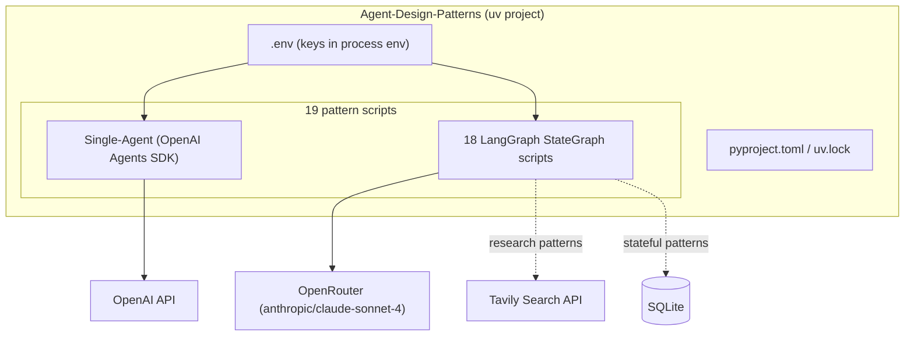
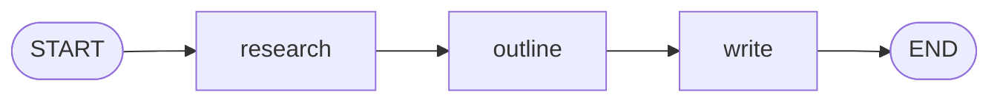
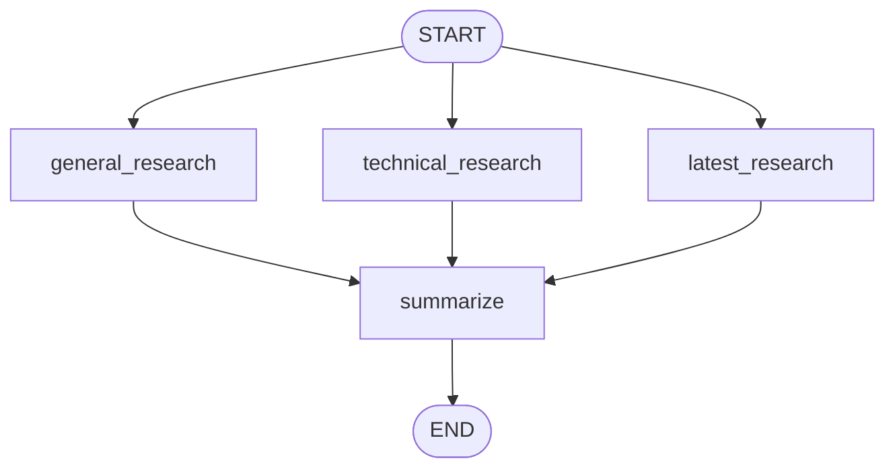
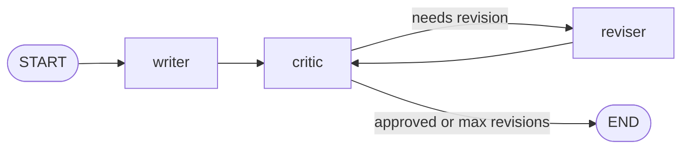
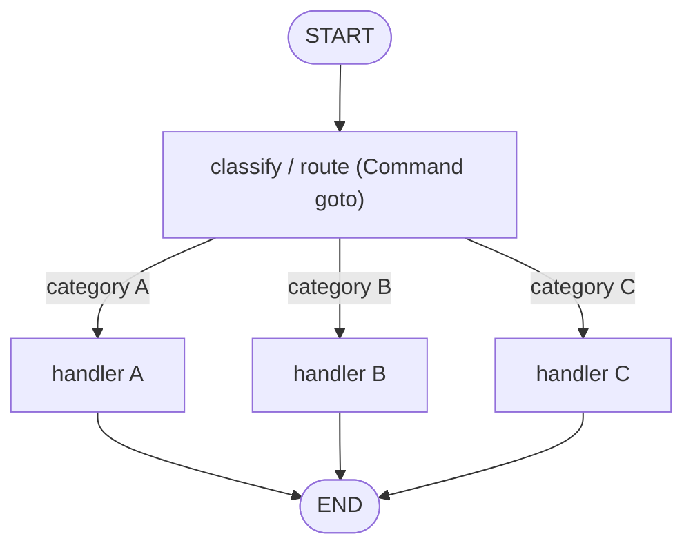

<div align="center">

# Agent Design Patterns

Nineteen AI agent design patterns, each a small, self-contained Python program you can read, run, and learn from.

[](https://www.python.org/)
[](https://docs.astral.sh/uv/)
[](https://openai.github.io/openai-agents-python/)
[](https://langchain-ai.github.io/langgraph/)
[](https://openrouter.ai/)
[](https://tavily.com/)
[](https://www.sqlite.org/)

</div>

## Overview

This repository collects nineteen common patterns for building LLM agents. Each pattern lives in its own folder as a single executable Python file with a module docstring that explains the pattern, its flow, and the LangGraph constructs it uses.

The examples are intentionally minimal. There is no shared framework or application layer to learn first: open any file, read the docstring, run it, and the whole pattern fits on one screen.

Two runtimes are used:

- **OpenAI Agents SDK** powers the single-agent example (`agents.Agent` with a built-in REPL loop).
- **LangGraph** powers the remaining eighteen examples, which are built as explicit `StateGraph` workflows. Several add SQLite for persistence and Tavily for web search.

All language-model calls (except the OpenAI Agents SDK example) go through [OpenRouter](https://openrouter.ai/) via `langchain-openrouter`, using the model `anthropic/claude-sonnet-4`.

## Features

- 19 runnable patterns, one file each, with a documented flow in every docstring.
- LangGraph building blocks demonstrated end to end: sequential chains, parallel fan-out/fan-in, conditional edges and loops, the `Command(update, goto)` routing primitive, and the dynamic `Send` API.
- Web-grounded research patterns using Tavily (`Parallel Agents`, `Sequential + Parallel`).
- Stateful patterns using SQLite for persistence (`Planner-Executor`, `Hierarchical Agent`, `Shared State / Blackboard`, `Planner-Executor-Reviewer`).
- Interactive patterns with human input loops (`Single Agent`, `Agent as Tool`, `Event-Driven`, `Human-in-the-Loop`).
- A single `uv` project: one lockfile, one `uv sync`, no per-folder setup.

## Patterns

| #  | Pattern                     | Project                                   | Stack                               |
|----|-----------------------------|-------------------------------------------|-------------------------------------|
| 1  | Single Agent                | AskBot (Chatbot)                          | OpenAI Agents SDK                   |
| 2  | Sequential Agent            | BlogFlow (Blog Generator)                 | LangGraph + OpenRouter              |
| 3  | Parallel Agents             | ResearchHub (Research Agent)              | LangGraph + Tavily + OpenRouter     |
| 4  | Sequential + Parallel       | NewsFlow (News Summarizer)                | LangGraph + Tavily + OpenRouter     |
| 5  | Orchestrator-Worker         | TaskMaster AI (Coding Task Manager)       | LangGraph + OpenRouter (Send API)   |
| 6  | Router / Classifier         | MailRouter (Email Classifier)             | LangGraph + OpenRouter (Command)    |
| 7  | Handoff                     | SupportFlow (Customer Support Bot)        | LangGraph + OpenRouter (Command)    |
| 8  | Agent as Tool               | ToolBot (Calculator Assistant)            | LangGraph + Python tools            |
| 9  | Planner-Executor            | PlanDo AI (To-Do List Planner)            | LangGraph + OpenRouter + SQLite     |
| 10 | Review & Critique           | CritiqueAI (Essay Checker)                | LangGraph + OpenRouter              |
| 11 | Review & Critique Loop      | ImproveLoop (Essay Improver)              | LangGraph + OpenRouter              |
| 12 | Reflection / Self-Critique  | SelfCheck AI (Code Improver)              | LangGraph + OpenRouter              |
| 13 | Debate / Multi-Agent        | DebateBot (Pros & Cons Generator)         | LangGraph + OpenRouter              |
| 14 | Consensus                   | ConsensusAI (Voting / Decision Agent)     | LangGraph + OpenRouter              |
| 15 | Hierarchical Agent          | TaskTree AI (Task Manager)                | LangGraph + OpenRouter + SQLite     |
| 16 | Human-in-the-Loop           | HumanApprove (Email Approval Bot)         | LangGraph + OpenRouter              |
| 17 | Event-Driven Agent          | EventBot (Reminder Bot)                   | LangGraph + OpenRouter (Command)    |
| 18 | Shared State / Blackboard   | SharedBrain (Shared Study Notes)          | LangGraph + OpenRouter + SQLite     |
| 19 | Planner-Executor-Reviewer   | PlanBuildReview (Task Completion System)  | LangGraph + OpenRouter + SQLite     |

> The `Single-Agent` example uses the OpenAI Agents SDK and reads `OPENAI_API_KEY`. Every other example uses LangGraph through OpenRouter and reads `OPENROUTER_API_KEY`. The two research patterns additionally read `TAVILY_API_KEY`.

## Tech Stack

| Area              | Technology                                             |
|-------------------|--------------------------------------------------------|
| Language          | Python 3.11+                                           |
| Package manager   | uv                                                     |
| Single-agent SDK  | `openai-agents` (OpenAI Agents SDK)                    |
| Graph framework   | `langgraph`                                            |
| LLM gateway       | `langchain-openrouter` (OpenRouter, `anthropic/claude-sonnet-4`) |
| Web search        | `tavily-python`                                        |
| Persistence       | SQLite (Python standard library `sqlite3`)             |

## Prerequisites

- **Python 3.11 or newer** (`requires-python >= 3.11`).
- **[uv](https://docs.astral.sh/uv/)** for dependency management and running.
- API keys:
  - `OPENROUTER_API_KEY` for the LangGraph examples (patterns 2 and above).
  - `OPENAI_API_KEY` for the Single Agent example (pattern 1).
  - `TAVILY_API_KEY` for the research examples (patterns 3 and 4).

Install uv (see the [uv install guide](https://docs.astral.sh/uv/getting-started/installation/) for other methods):

```bash
# macOS / Linux
curl -LsSf https://astral.sh/uv/install.sh | sh

# Windows (PowerShell)
powershell -c "irm https://astral.sh/uv/install.ps1 | iex"
```

## Installation

Clone the repository and sync dependencies from the lockfile:

```bash
git clone <your-fork-url> Agent-Design-Patterns
cd Agent-Design-Patterns
uv sync
```

## Environment Variables

Copy the example file and fill in the keys you need:

```bash
cp .env.example .env
```

```ini
# .env
OPENAI_API_KEY=your_api_key
OPENROUTER_API_KEY=your_api_key
TAVILY_API_KEY=your_api_key
```

The SDKs read these from the process environment; the code does not load `.env` automatically. Export the values into your shell before running (or use a loader such as `uv run --env-file .env`):

```bash
# macOS / Linux
set -a; source .env; set +a

# Windows (PowerShell)
Get-Content .env | ForEach-Object {
  if ($_ -match '^\s*([^#][^=]*)=(.*)$') { Set-Item "env:$($matches[1].Trim())" $matches[2].Trim() }
}
```

```bash
# Or let uv load the file per run
uv run --env-file .env python "Single-Agent/Chatbot.py"
```

## Development Commands

Each pattern is a standalone script. Run any example with `uv run`:

```bash
# Pattern 1 - Single Agent (OpenAI Agents SDK)
uv run python "Single-Agent/Chatbot.py"

# Pattern 2 - Sequential Agent
uv run python "Sequential-Agent/Blog-Generator.py"

# Pattern 3 - Parallel Agents (requires TAVILY_API_KEY)
uv run python "Parallel Agents/Research-Agent.py"

# Pattern 8 - Agent as Tool
uv run python "Agent-As-Tool/Calculator-Assistant.py"

# Pattern 19 - Planner-Executor-Reviewer
uv run python "Planner-Executor-Reviewer/Task-Completion-System.py"
```

All examples are interactive and prompt for input on stdin. The SQLite-backed patterns create their database file (for example `todos.db`, `task_tree.db`, `blackboard.db`, `plan_build_review.db`) in the current working directory on first run.

Common tasks:

```bash
uv sync            # install / update dependencies from the lockfile
uv add <package>   # add a dependency
uv run python ...  # run a script inside the project environment
```

## Architecture

The repository is a flat set of pattern folders sharing one `uv` environment. Each script wires an LLM provider (and optionally Tavily or SQLite) into either an OpenAI Agents SDK agent or a LangGraph `StateGraph`.



## Workflow Patterns

The LangGraph examples cover four structural shapes. Representative flows:

**Sequential chain** (`Sequential-Agent`, `Review-Critique`, `Reflection-Self-Critique`):



**Parallel fan-out / fan-in** (`Parallel Agents`, `Debate-Multi-Agent`, `Consensus`, `Shared-State-Blackboard`):



**Conditional loop** (`Review-Critique-Loop`, `Planner-Executor`, `Human-In-The-Loop`, `Planner-Executor-Reviewer`):



**Command routing and dynamic dispatch** (`Router-Classifier`, `Handoff`, `Event-Driven-Agent` use `Command(goto)`; `Orchestrator-Worker` and `Hierarchical-Agent` use the `Send` API):



## Deployment

These are local, interactive learning scripts rather than a deployable service. There is no server, container, or long-running process to host. To run them elsewhere, reproduce the same three steps on the target machine:

1. Install Python 3.11+ and uv.
2. Run `uv sync` to restore the exact dependency set from the lockfile.
3. Provide the required API keys in the environment and run the desired script with `uv run`.
